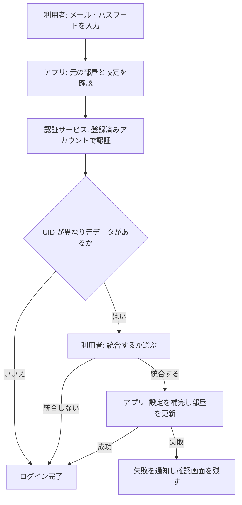

# 認証とデータ引き継ぎの仕様

## 概要

アプリを開くと匿名認証で利用を始められる。メールアドレスを登録すれば同じ UID を別の端末でも使える。既存アカウントへログインする場合は、元の部屋データと設定を引き継ぐか選べる。

| 項目             | 内容                                                                                                                                                                                         |
| ---------------- | -------------------------------------------------------------------------------------------------------------------------------------------------------------------------------------------- |
| 対象システム／ID | `mahjong-point-manager`／FNC-004                                                                                                                                                             |
| 状態             | 草案。引き継ぎには対象データと失敗時の未決事項あり                                                                                                                                           |
| 共通仕様         | [製品仕様](specification.md)                                                                                                                                                                 |
| 根拠             | [認証コンテキスト](../src/contexts/AuthContext.tsx)、[認証画面](../src/components/features/AuthModal.tsx)、[移行処理](../src/services/migrationService.ts)、[認可ルール](../firestore.rules) |

## 1. 匿名のまま利用し、必要な時に登録する

| ID      | 条件・主体                           | 現行動作                                                                                                        |
| ------- | ------------------------------------ | --------------------------------------------------------------------------------------------------------------- |
| REQ-201 | アプリを開いた利用者に認証情報がない | 匿名認証を開始し、完了後に利用する。認証失敗時は再読み込みを案内する                                            |
| REQ-202 | 利用者が新規登録                     | メールアドレス、6文字以上のパスワード、確認用パスワードを入力し、現在の認証アカウントへメール認証情報を追加する |
| BR-201  | 新規登録時                           | パスワード不一致を拒否する。登録に成功しても UID は変えず、部屋や個人データの付け替えは行わない                 |

パスワードの強さを画面に表示するが、判定表示そのものを登録拒否の条件にはしていない。使用済みメールアドレスや弱いパスワードなどの認証サービスのエラーを通知する。アカウント登録による UID の維持と、バックアップからの復元は別の仕組みとして扱う。

## 2. ログインと引き継ぎの選択

| ID      | 条件・主体                               | 現行動作                                                                                                                  |
| ------- | ---------------------------------------- | ------------------------------------------------------------------------------------------------------------------------- |
| REQ-203 | 利用者が既存アカウントへログイン         | 切り替え前の部屋履歴の有無と個人設定を調べる。切り替え先の UID が異なり、元の部屋または設定があれば引き継ぎ確認を表示する |
| BR-202  | 引き継ぎ確認で選択                       | 「統合する」なら対象データを移す。「統合しない」なら移行せず、ログイン先のアカウントを使う                                |
| REQ-204 | 利用者が統合を選択                       | 下記の対象を元 UID から新 UID へ置き換える。移行先に設定がある場合は上書きしない                                          |
| BR-203  | 設定の統合                               | 移行先に設定がない場合だけ、ログイン前に取得した元の設定を複製する                                                        |
| REQ-205 | 利用者がパスワード再設定またはログアウト | 入力したメールアドレスへ再設定メールを依頼する。ログアウト後は再読み込みし、再び匿名認証で利用する                        |

移行を取り消してもログインは取り消さない。画面には元データを「破棄する」とあるが、現行処理では元データを削除しない。元 UID での再認証や再表示を保証する機能もないため、元データの復元手段とは扱わない。

## 3. 引き継ぐデータと残るデータ

| ID      | データ要件                                                                                                                 |
| ------- | -------------------------------------------------------------------------------------------------------------------------- |
| DAT-201 | 部屋の参加者・ホスト・保存済み成績の UID を新 UID へ置き換え、本人の履歴から参照できるようにする。個人設定は BR-203 に従う |

対象の部屋は、参加 ID 一覧に元 UID があるものを取得する。現在の実装で更新する範囲は次のとおり。

| 対象             | 更新する内容                                                          |
| ---------------- | --------------------------------------------------------------------- |
| 部屋             | 参加 ID、参加者の ID、ホスト ID                                       |
| 保存済み対局結果 | 成績の参加者 ID、局ログの和了者・放銃者・リーチ者、点数移動の ID キー |
| 最後の点数変動   | 点数移動の ID キー                                                    |
| 個人設定         | 移行先にない場合だけ、元の設定を複製                                  |

保存済み結果は別保存の履歴を優先して読み、移行後も別保存する。旧形式で部屋本体にある結果も読み取る。

一方、進行中の局ログ、取り消し用の過去状態、保存済み局ログのテンパイ者一覧、分析ノート、大会・シリーズの主催者や参加者参照は移行しない。旧仕様の「すべてのデータを引き継ぐ」を満たしたとは扱わない（Q-201）。

## 4. 権限と失敗時の扱い

認証とパスワード管理は Firebase Authentication、データの読み書きは Firestore に依存する。Cloud Functions による移行処理はなく、ログイン後のクライアントが更新する。

部屋の更新は、更新前または更新後の参加 ID にログイン中の UID が含まれれば許可される。一方、個人設定は本人だけが読めるため、元の設定をログイン前に取得する。分析ノートには本人限定の認可があり、他 UID への移行処理もない。

部屋と履歴の更新はバッチにまとめるが、設定の複製はその前に別途実行する。大量データ向けの分割バッチ、全体の取り消し、再開地点の保存は実装されていない。移行全体の成功と、各段階の成功を同じ扱いにしない（Q-202）。

## 5. 関連仕様・設計

個人設定と認証切り替え時の表示条件は[共通仕様](specification.md#5-ユーザー設定fnc-005)、分析ノートの所有範囲は[詳細分析](detailed-analysing.md)を参照する。外部設計は[既存の外部設計](external_design.md)を参考とするが、現在の登録・引き継ぎ画面との対応は未整理。

## 6. 受入条件

| ID     | 対応要件                 | 前提・操作                                                         | 期待結果・確認方法                                                                                                |
| ------ | ------------------------ | ------------------------------------------------------------------ | ----------------------------------------------------------------------------------------------------------------- |
| AC-201 | REQ-201                  | 認証情報がない状態で起動し、認証成功／失敗を発生させる             | 成功時に UID を得て、失敗時に再読み込みを案内する。認証コンテキストと画面で確認                                   |
| AC-202 | REQ-202、BR-201          | 匿名の部屋を持つ利用者が登録。不一致・使用済みアドレスも試す       | 成功時に UID とデータを維持し、不正入力・認証エラーを通知する。認証画面と UID を確認                              |
| AC-203 | REQ-203、BR-202          | 元 UID に部屋または設定がある状態で別 UID へログインし、統合しない | 確認を表示し、元のデータを書き換えず、新 UID の利用を続ける。認証画面のテストと保存状態を確認                     |
| AC-204 | REQ-204、BR-203、DAT-201 | 統合する。移行先設定あり／なし、旧形式／別保存の結果を比較         | 対象欄の UID を置換し、移行先設定を優先する。移行サービスの既存テストで確認。対象外データまで移行済みと判定しない |
| AC-205 | REQ-205                  | メール未入力／入力済みで再設定を依頼し、ログアウトする             | 未入力は案内し、入力済みは再設定メールを依頼する。ログアウト後は匿名認証に戻る。画面と認証状態を確認              |

## 7. 未決事項

確認先・期限は未定、状態は未回答。旧仕様の要望を取り下げたことにはしない。

| ID    | 質問・提案                                                                                                                                | 影響先                             |
| ----- | ----------------------------------------------------------------------------------------------------------------------------------------- | ---------------------------------- |
| Q-201 | 分析ノート・大会・シリーズ・進行中ログ・操作履歴・テンパイ者も含めて引き継ぐか。対象一覧を確定し、旧 UID を参照し続ける箇所の扱いを決める | REQ-204、DAT-201、個人の成績と権限 |
| Q-202 | 大量データ、途中失敗、同じ部屋に新旧 UID がいる場合、繰り返し実行をどう扱うか。分割・再開・整合確認と認可を含む移行方式を決める           | REQ-204、DAT-201、復旧手順         |
