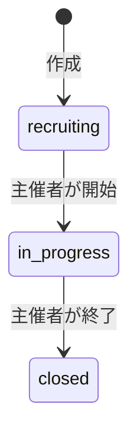

# 麻雀大会・大会シリーズの仕様

## 概要

大会では参加者を複数の卓へ配置し、対局結果を集計する。大会シリーズでは開催回ごとの参加者を同じ人物に紐付け、複数大会の成績を合算する。

| 項目             | 内容                                                                                                                                                                                  |
| ---------------- | ------------------------------------------------------------------------------------------------------------------------------------------------------------------------------------- |
| 対象システム／ID | `mahjong-point-manager`／FNC-007・008                                                                                                                                                 |
| 状態             | 草案。閲覧範囲、終了制御、結果保存などに未決事項あり                                                                                                                                  |
| 共通仕様         | [製品仕様](specification.md)、[ゲームルール](game_rules.md)                                                                                                                           |
| 根拠             | [大会サービス](../src/services/competitionService.ts)、[シリーズサービス](../src/services/competitionSeriesService.ts)、[型](../src/types/index.ts)、[認可ルール](../firestore.rules) |

単大会の参加・配置・対局・実況・レポートと、シリーズの参加者・開催回・名寄せ・集計を対象とする。スイスドロー、対戦相手の重複回避、予選・決勝などの大会内ステージ、チーム戦、通知、決済は現行の対象外。

## 1. 用語と利用者

| 用語       | 意味                                                                          |
| ---------- | ----------------------------------------------------------------------------- |
| 大会       | 参加者・卓・対局結果を持つ1回のイベント                                       |
| 主催者     | 大会作成者。大会設定と開始・終了を管理する                                    |
| 共同主催者 | 主催者から卓・配置・対局の管理を任された利用者                                |
| 参加者     | 大会に登録された人。認証 UID がある人と、名前だけで代理登録された人を区別する |
| 卓         | 3人打ちまたは4人打ちの対局場所                                                |
| 卓ランク   | 自動配置で優先する順序。1〜5で、1を先に埋める                                 |
| シリーズ   | 複数の大会を第1回、第2回などの開催回として束ねたもの                          |
| 名寄せ     | 開催回の参加者を、シリーズ内で同じ人物として扱う参加者 ID に紐付けること      |

本書の管理者は、操作対象の大会またはシリーズの主催者・共同主催者を指す。両方に関わる操作では、各節に権限条件を示す。

匿名認証にも UID があるため、アカウント未登録の参加者と、主催者が名前だけで登録する代理参加者は同じ扱いではない。前者は自分の端末で操作し、共同主催者にも任命できる。後者は認証 UID を持たず、本人の個人履歴・分析ノートには直接紐付かない。

## 2. 大会の作成から終了まで（FNC-007）

| ID      | 条件と現行動作                                                                                                                                                      |
| ------- | ------------------------------------------------------------------------------------------------------------------------------------------------------------------- |
| REQ-401 | 認証済み利用者が大会名、説明、任意の参加パスコードと共通ルールを指定して作成する。主催者本人を参加者に追加するか選べる                                              |
| BR-401  | 大会名はフォームで50文字、説明は500文字まで。主催者の自動参加は既定で有効で、参加時は空白だけの表示名を拒否する。ルールの画面編集は主催者かつ募集中の場合に提供する |
| REQ-402 | 主催者が確認操作を経て大会を開始・終了する。開始時刻・終了時刻を記録する                                                                                            |

`archived`（アーカイブ）は型と表示上の状態として存在するが、現在の画面には移行操作がなく、自動移行バッチもない。旧仕様の一定期間後の自動アーカイブは未実装。

大会は4人打ち用と3人打ち用の原点・返し点を持ち、卓の人数に応じて対局ルールを組み立てる。その他の設定は大会共通とする。既定値は[製品仕様の設定表](specification.md#32-設定の初期値)を参照する。

大会一覧の取得対象は、ログイン中の利用者が主催者である大会。旧仕様にあった「参加中の大会すべて」の一覧ではない。参加者は共有 URL 等から対象の大会を開く。

## 3. 参加登録・共有・共同主催者

| ID      | 条件と現行動作                                                                                                                                                                                                                           |
| ------- | ---------------------------------------------------------------------------------------------------------------------------------------------------------------------------------------------------------------------------------------- |
| REQ-403 | 利用者が参加 URL・QR コードを開き、表示名と必要なパスコードを入力して参加する。主催者は名前だけの参加者も代理登録できる                                                                                                                  |
| BR-402  | 本人参加は認証 UID を参加者 ID に使う。既存の本人登録があれば重複追加しない。募集・進行中だけ参加画面を提供し、名前が空白だけの場合と日本語変換中の確定操作を抑止する。本人の表示名は前後の空白を除いて保存し、参加者名は1〜32文字とする |
| REQ-404 | 主催者が UID のある参加者を共同主催者へ任命・解除し、管理操作を共有できる                                                                                                                                                                |
| BR-403  | 共同主催者の任命・解除は募集・進行中の画面で提供する。大会設定・大会開始終了・共同主催者の変更は主催者だけ、卓・配置・大会結果作成は主催者または共同主催者に許可する                                                                     |

パスコードは大会 ID を加えた SHA-256 の値を秘密領域へ保存し、平文やハッシュを大会本体・共有 URL に含めない。本人用の検証記録を書き込む際に、認可ルールが秘密領域の値と照合する。秘密領域の読み取りは拒否する。成功後は参加登録に進め、誤りなら参加しない。

パスコードは参加登録の検証と実況画面の入口に使う。大会本体、参加者、卓、結果は匿名を含む認証済み利用者が読めるため、「参加者だけが大会の詳細を閲覧できる」という保護にはなっていない（Q-401）。

## 4. 卓を作り、参加者を配置する

| ID      | 条件と現行動作                                                                                                                                                                                         |
| ------- | ------------------------------------------------------------------------------------------------------------------------------------------------------------------------------------------------------ |
| REQ-405 | 主催者・共同主催者が卓名、人数、卓ランクを指定して作成し、待機中の参加者を選んで配置・解除する。開始前の席順を並べ替え、またはランダムに設定できる                                                     |
| BR-404  | 卓は定員未満を `open`、定員に達すると `ready`、対局開始後を `playing` とする。参加者は未配置 `idle`、配置済み `assigned`、対局中 `playing` を持ち、所属卓を記録する。既存の卓でランク未設定なら1とする |
| REQ-406 | 管理者が自動配置案を作り、対象卓・追加人数・未配置者を確認して確定する。既存の手動配置を維持し、状況が変わった場合は案を更新して再確認を求める                                                         |

手動配置は同時に複数人を選べるが、残席数を超えない。解除時は他の人の席順を保持する。卓を削除する場合は所属者を待機状態へ戻す。

自動配置は次の順に決める。根拠は[配置計算](../src/utils/autoTableAssignment.ts)と[確定処理](../src/services/competitionService.ts)。

1. `idle` の参加者を、合計ポイント降順、平均順位昇順、参加日時昇順、参加者 ID 順に並べる。未対局者は0ポイント、平均順位なしとして扱う。
2. `open` または `ready` で空席のある卓を、卓ランク昇順、作成日時昇順、卓名、卓 ID の順で並べる。
3. 既存の配置を残して空席へ順番に追加する。全卓を埋めても余る人は未配置のまま表示する。
4. 確定前に最新の案と比較する。保存時も対象卓・参加者を読み直し、人数・状態・ランク・既存配置が変わっていれば確定を中止する。

組み合わせの公平性や過去の同卓回数は評価しない。自動配置が成功すると、卓と参加者をまとめて確定する処理（トランザクション）で更新する。

## 5. 卓での対局と結果保存

| ID      | 条件と現行動作                                                                                                                                                               |
| ------- | ---------------------------------------------------------------------------------------------------------------------------------------------------------------------------- |
| REQ-407 | 管理者が定員に達した卓から対局を開始する。大会ルールと席順で部屋を作り、通常の対局と共通の和了・流局・リーチ・取り消しを使う。終了後は結果を保存し、次戦または卓の解散へ進む |

対局用の部屋では、認証 UID のある参加者はその UID、名前だけの参加者は大会参加者 ID を使う。対局を開始した管理者の UID も参加 ID に加え、操作できるようにする。

対局終了を卓画面が検知し、クライアントから大会結果を保存する。サーバーの自動トリガーではない。結果 ID は卓 ID と対局結果 ID から作り、認可ルールでは主催者・共同主催者による新規作成だけを許可する。作成済み結果の更新・削除はできない。再読み込みや複数端末での再保存、一般参加者の端末だけが終了を検知する場合の完了保証は Q-403 に残す。

次戦では新しい部屋を作り、持ち点・チップ・リーチ状態を初期化する。卓を解散すると、配置・席順・現在の部屋への参照・卓の対局カウンターを空にし、参加者を待機状態へ戻す。保存済み大会結果は消さない。卓の `finished` は型上存在するが、この流れでは部屋の終了状態を使って結果表示を切り替える。

途中終了は成績に反映するか選べる。反映する場合は途中終了の対局結果を保存し、反映しない場合は結果を追加しない。供託の処理は[ゲームルール](game_rules.md#4-自動終了と途中終了)を参照する。

## 6. 実況と単大会レポート

| ID      | 条件と現行動作                                                                                                                                             |
| ------- | ---------------------------------------------------------------------------------------------------------------------------------------------------------- |
| REQ-408 | 閲覧者が全卓の点数・局・リーチ状態と総合成績を実況画面で確認できる。大会レポートは総合成績・対局別詳細・卓別サマリを表示し、CSV とブラウザ印刷へ出力できる |
| DAT-401 | 大会本体、参加者、卓、変更不可の対局結果を保持する。結果は対局時のルールと各人の成績を含み、集計値は保存済み結果からその都度求める                         |

実況画面は卓名順に並べ、投影向けに自動スクロールを選べる。メール登録は不要だが、匿名認証を含む認証は必要となる。パスコード付き大会では実況の入口で入力を求める。

単大会の順位は精算ポイントの合計降順で、対局数による補正は行わない。同点時の業務上の優先条件は定められておらず、現行は集計に入った順に連番を付ける。平均順位は小数1桁へ丸める。チップ有効時だけチップ列を表示するが、結果生成時の収支が0となる制約はゲームルールの Q-102 を参照する。

対局別の表示番号は卓名と結果時刻を使って再採番する。保存値の `gameIndex` は初回0から始まり、卓カウンターも次戦開始時に増えるため、旧仕様の「完了対局数・1始まりの番号」と一致しない。レポートの卓別対局数を確定件数とみなす扱いも Q-403 で確認する。

CSV は総合成績と対局別詳細を含み、チップ無効ならチップ列を省く。UTF-8 の BOM を付け、区切り文字・改行・引用符を処理し、式として解釈される先頭文字を保護する。PDF はブラウザの印刷ダイアログを使い、利用者が保存先を選ぶ。PDF ファイルのサーバー生成・保存は行わない。結果0件では出力ボタンを無効にする。

## 7. 開催回を束ねる大会シリーズ（FNC-008）

### 7.1 作成・参加・開催回の追加

| ID      | 条件と現行動作                                                                                                                                                          |
| ------- | ----------------------------------------------------------------------------------------------------------------------------------------------------------------------- |
| REQ-501 | 認証済み利用者がシリーズ名、任意の説明と期間を指定して作成する。参加リンク・QR コードから本人が表示名を入力して参加できる                                               |
| BR-501  | シリーズ名は前後空白を除いて1〜50文字、参加者名は1〜32文字。期間の両端があれば終了日を開始日以降とする。本人登録は本人の UID を ID とし、有効な参加者として新規作成する |
| REQ-502 | 管理者がシリーズ参加者を追加・無効化し、有効な人だけを各開催回へ追加する。既存大会を未使用の正整数の回番号へ紐付け・解除できる                                          |
| BR-502  | 大会とシリーズの紐付け・解除には、シリーズの主催者または共同主催者であり、かつ対象大会の主催者であることが必要。既存回の上書き、別シリーズへの重複所属を拒否する        |

シリーズ一覧もログイン中の利用者が主催者であるものを取得する。本人がすでにシリーズ参加者に登録されていれば追加せず、シリーズ画面へ進む。本人による登録後の変更は許可せず、管理者が変更する。

シリーズ画面から新しい開催回を作成する場合は、大会作成後にシリーズへ紐付ける。紐付け自体は大会側と開催回側を同時更新するが、大会の新規作成まで同じ処理で確定するわけではない。失敗時には作成済み大会が残り得るため、既存大会の紐付けから再処理する。

シリーズ参加者を無効化しても過去成績は残す。開催回へ追加すると独立した大会参加者 ID を発行し、シリーズの参加者 ID を別に保持する。日程は管理情報であり、期間外の登録や対局を自動禁止する条件には使わない。

### 7.2 名寄せと一括割り当て

| ID      | 条件と現行動作                                                                                                                                                                                        |
| ------- | ----------------------------------------------------------------------------------------------------------------------------------------------------------------------------------------------------- |
| REQ-503 | 管理者が開催回参加者をシリーズ参加者へ手動で名寄せ・解除できる。未名寄せの開催回参加者をまとめてシリーズへ取り込める                                                                                  |
| BR-503  | 一括処理は一意な UID 一致、一意な名前一致の順で既存参加者を再利用する。名前は前後空白を除き、大文字小文字を同一視する。一致しない場合は新規作成し、同じ開催回の複数人を同じシリーズ参加者にまとめない |

名寄せ済みの参加者は一括処理で変更しない。新しいシリーズ参加者の作成と開催回参加者の名寄せ更新を同じバッチで保存する。手動名寄せでも、同じ開催回の複数人を同じシリーズ参加者へ紐付けないよう確認する。

認可ルールでは、大会側の管理者であることに加え、シリーズ側の管理権限と名寄せ先の存在を確認する。シリーズだけ、または大会だけの管理者なら、すべての管理操作を行えるとは限らない。

### 7.3 集計と初回配置

| ID      | 条件と現行動作                                                                                                                                                             |
| ------- | -------------------------------------------------------------------------------------------------------------------------------------------------------------------------- |
| REQ-504 | 名寄せ済みの結果から、合計ポイント、総合順位、平均順位、チップ収支、対局数、参加回数、開催回別内訳を表示する。成績はあるが名寄せされていない参加者は集計から外して警告する |
| REQ-505 | 現在の開催回に結果がなく、他の開催回のシリーズ成績がある場合、初回の自動配置にシリーズ成績を使うか選べる。結果が1件でもあれば現在の大会の成績を使う                        |
| REQ-506 | シリーズレポートで総合成績と開催回別内訳を表示し、ブラウザ印刷から PDF 保存できる。成績はあるが名寄せされていない参加者や取得不能な開催回がある場合は出力を無効にする      |
| DAT-501 | シリーズ、安定した参加者 ID、有効状態、開催回、大会との相互参照、開催回参加者との名寄せを保持する。集計値は重複保存しない                                                  |

総合順位は合計ポイント降順、平均順位昇順、シリーズ参加日時昇順、参加者 ID 順に決める。参加回数は成績が1件以上ある開催回数。欠席回を0点として対局数や平均順位に加えず、足切り・ベスト数回方式は使わない。

初回配置の評価値はシリーズ参加者 ID を介して当日の参加者へ渡す。ただし現行の取得範囲は現在の大会を除く全開催回で、回番号が前のものだけには絞っていない。旧仕様の「前回まで」との差異は Q-501 で扱う。

シリーズレポートは、募集・進行中の開催回を含む場合に途中結果と表示し、集計日時を付ける。少なくとも1開催回でチップを使う場合はチップ列を表示する。結果0件も PDF 出力不可。印刷は A4 横向きで、シリーズの CSV 出力はない。参加者・結果の購読失敗を空配列として受け取る箇所があり、すべての取得失敗を検出できる保証はない（Q-403）。

## 8. アクセス・運用条件と関連設計

| 対象                             | 現行の認可ルール                                                                                               |
| -------------------------------- | -------------------------------------------------------------------------------------------------------------- |
| 大会・参加者・卓・結果の閲覧     | 認証済み利用者。匿名を含む                                                                                     |
| 大会本体の更新                   | 主催者。主催者 ID は変更不可                                                                                   |
| 参加者の作成                     | 管理者または本人登録。パスコード付き大会では検証記録も必要                                                     |
| 参加者の更新／削除               | 更新は主催者・共同主催者、削除は主催者                                                                         |
| 卓の作成・更新・削除             | 主催者・共同主催者                                                                                             |
| 大会結果                         | 作成は主催者・共同主催者。更新・削除は拒否                                                                     |
| シリーズ・メンバー・開催回の閲覧 | 認証済み利用者。匿名を含む                                                                                     |
| シリーズ本体の更新／削除         | 更新は主催者・共同主催者、削除は主催者                                                                         |
| シリーズメンバー                 | 管理者が作成・更新・削除。本人は本人 ID の有効メンバーを新規作成可能                                           |
| 開催回                           | シリーズ管理者であり対象大会の主催者でもある利用者が、双方の参照を同時に更新して作成・削除。作成後の上書き不可 |

オンライン条件と非機能目標は[共通仕様](specification.md#6-共通データ非機能要件と制約)に従う。旧仕様の実況遅延2秒、100人、25卓、無期限保持は、測定条件や運用上の合意を確認できないため、共通の Q-003 に引き継ぐ。上限を実装済みの制約とも、検証済みの性能とも扱わない。

画面の経路は [App.tsx](../src/App.tsx) が根拠となる。大会一覧・作成・ダッシュボード・参加・卓・実況・レポート、およびシリーズ一覧・作成・ダッシュボード・参加・レポートを持つ。[既存の外部設計](external_design.md)には大会・シリーズの要件対応が未整理であり、専用の画面・帳票設計は未作成。

## 9. 受入条件

| ID     | 対応要件                 | 前提・操作                                                     | 期待結果・確認方法                                                                                                     |
| ------ | ------------------------ | -------------------------------------------------------------- | ---------------------------------------------------------------------------------------------------------------------- |
| AC-401 | REQ-401、BR-401          | 主催者の自動参加あり／なし、パスコードあり／なしで大会作成     | 募集状態で保存し、本人追加を選べる。パスコードを大会本体へ置かない。フォーム・作成画面・サービスのテストで確認         |
| AC-402 | REQ-402、BR-403          | 主催者が開始・終了を確定し、共同主催者から本体更新を試す       | 開始・終了時刻を記録し、共同主催者による本体更新は拒否する。画面・認可ルールで確認。終了後の全操作禁止は Q-402 の対象  |
| AC-403 | REQ-403、BR-402          | 本人が参加、再参加、空白名・変換中入力・誤ったパスコードで確定 | 正常時だけ登録し、重複追加せず、不正条件を拒否する。参加画面・検証・認可ルールを確認                                   |
| AC-404 | REQ-404、BR-403          | 募集・進行中に UID あり／なしの参加者を任命・解除              | UID のある人だけを任命・解除でき、終了後は操作を隠す。参加者一覧・サービス・認可ルールのテストで確認                   |
| AC-405 | REQ-405、BR-404          | 3人／4人卓を作成し、手動配置・解除・削除                       | 定員と席順、所属・状態を更新し、削除時に参加者を待機へ戻す。卓操作とサービスのテストで確認                             |
| AC-406 | REQ-406                  | 手動配置を含む卓へ自動案を作り、案表示中に対象の状態を変える   | 配置済みの人を維持し、状態変化時に再確認・再作成を求める。計算・モーダル・確定処理のテストで確認                       |
| AC-407 | REQ-407、DAT-401         | 管理者が対局を開始し、成績を残す／残さないで終了、次戦・解散   | 新しい部屋と卓を紐付け、結果の保存有無を反映する。解散後も過去結果は残す。卓画面・サービスを確認                       |
| AC-408 | REQ-408、DAT-401         | 結果あり／なしで実況・レポート・CSV・印刷を開く                | 集計とチップ列の条件を満たし、0件なら出力不可。CSV は式の先頭文字等を保護する。集計・出力のテストと画面で確認          |
| AC-501 | REQ-501、BR-501          | シリーズを作成し、本人が参加。空白名・逆転期間も試す           | 有効メンバーを本人 ID で登録し、登録済みなら重複させない。不正な名前・期間を拒否する。サービス・参加画面のテストで確認 |
| AC-502 | REQ-502、BR-502、DAT-501 | 有効／無効メンバーを開催回へ追加し、大会を紐付け・解除         | 有効な人だけ追加し、大会と開催回の参照を同時に更新する。既存回・他シリーズの重複を拒否する。サービス・認可テストで確認 |
| AC-503 | REQ-503、BR-503          | UID 一致、名前一致、不一致、名寄せ済みを含め一括・手動処理     | 本文の優先順で既存メンバーを再利用し、未一致は作成する。同じ開催回で重複統合しない。名寄せ計算・サービスのテストで確認 |
| AC-504 | REQ-504、DAT-501         | 複数回の結果、欠席、無効メンバー、未名寄せを集計               | 名寄せ済み結果と過去成績を保持し、参加回数を結果のある回だけ数える。未名寄せを警告する。シリーズ集計テストで確認       |
| AC-505 | REQ-505                  | 現在の大会の結果0件／1件以上で初回配置案を作る                 | 0件ではシリーズ成績を選べ、1件以上では現在の大会の成績を使う。配置計算・フックを確認                                   |
| AC-506 | REQ-506                  | 募集・進行中の回、未名寄せ、取得不能回、結果0件を含むレポート  | 途中結果・警告を表示し、不完全または0件なら印刷不可。シリーズレポートの既存テストで確認                                |

## 10. 旧仕様との差異と未決事項

全項目の確認先・期限は未定、状態は未回答。提案への合意を得るまでは仕様変更と扱わない。

| ID    | 質問・提案                                                                                                                                                                                                                                                                     | 影響先                                   |
| ----- | ------------------------------------------------------------------------------------------------------------------------------------------------------------------------------------------------------------------------------------------------------------------------------ | ---------------------------------------- |
| Q-401 | パスコードを参加条件だけにするか、大会の閲覧も制限するか。旧仕様の参加者限定閲覧を維持するなら、実況・レポートと認可をまとめて見直す                                                                                                                                           | REQ-403・408、認可、共有範囲             |
| Q-402 | 大会終了後の更新禁止をどこまで強制するか。現行の認可は卓操作等に大会状態を条件とせず、終了後も操作できる経路がある。募集中の卓の直接開始、進行中卓がある時の終了警告、アーカイブ移行も決める。旧仕様の大会名・説明・パスコード編集も、現在は画面から行えないため対象を確認する | REQ-402・405・407、状態と権限            |
| Q-403 | 結果の確実な保存・重複処理・再試行をどう保証するか。現行は卓画面のクライアント保存で、再保存は認可で拒否される。対局番号と完了数、単大会の同点順位、購読失敗時の出力制御も整理する                                                                                             | REQ-407・408・506、DAT-401、成績の完全性 |
| Q-404 | 次戦の席順編集をどう保存するか。現行画面は並べ替えを表示するが、開始処理へその並びを渡していない。卓の席順との整合も含めて修正範囲を決める                                                                                                                                     | REQ-407、次戦の自風・同点順位            |
| Q-405 | パスコード付き大会での主催者自動参加・代理登録に検証を要求するか。現行ルールは管理者作成にも検証記録を要求するが、新規作成時の自動参加などではその記録を作らないため、途中で失敗し得る                                                                                         | REQ-401・403・502、作成済みデータの復旧  |
| Q-501 | 初回配置に使うシリーズ成績を「前回まで」に限定するか。現行は現在の大会以外の全開催回を使うため、後の回の結果も入り得る                                                                                                                                                         | REQ-505、卓ランクへの割り当て            |
