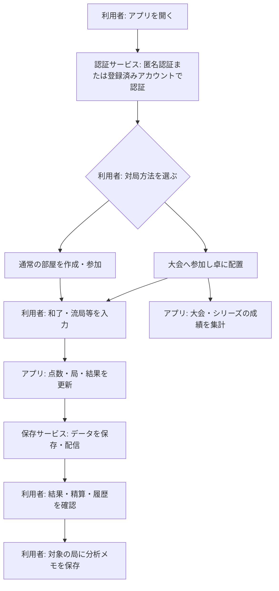
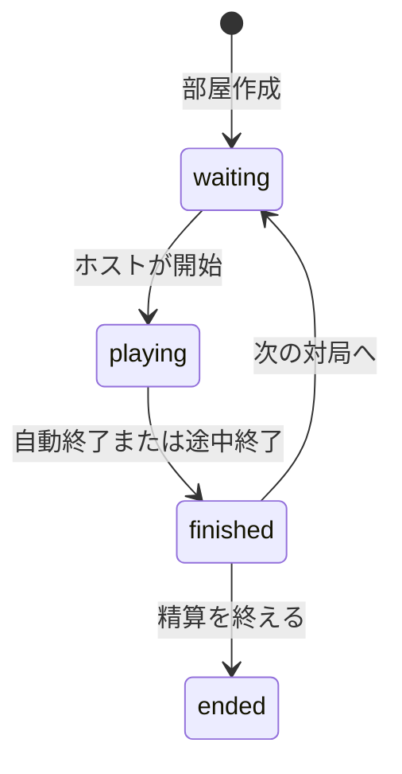

# 麻雀点数管理アプリ 仕様書

## 概要

点数の記録、局の進行、対局後の精算をブラウザで管理する。通常の部屋に加え、複数卓の大会、複数大会を束ねるシリーズ、個人の分析ノートを扱う。

| 項目         | 内容                                                                                                                                                                                              |
| ------------ | ------------------------------------------------------------------------------------------------------------------------------------------------------------------------------------------------- |
| 対象システム | `mahjong-point-manager`                                                                                                                                                                           |
| 対象 ID      | 共通、FNC-001、FNC-003、FNC-005                                                                                                                                                                   |
| 状態         | 草案。現行動作をソースから整理したもので、未決事項は未合意                                                                                                                                        |
| 調査基準日   | 2026年11月1日                                                                                                                                                                                     |
| 読者         | 利用者、保守担当者、設計・テスト担当者                                                                                                                                                            |
| 根拠         | [画面とルーティング](../src/App.tsx)、[型定義](../src/types/index.ts)、[部屋サービス](../src/services/roomService.ts)、[対局処理](../src/hooks/useMatchGame.ts)、[認可ルール](../firestore.rules) |

本文の「現行動作」は実装の観察結果を示す。旧仕様と異なる動作を、そのまま仕様変更の決定とは扱わない。差異は各文書の未決事項に残し、受入条件も現行動作を確認するための条件として記載する。

## 1. 文書一覧と管理方針

既存の配置を維持し、この文書を文書一覧と共通仕様の入口とする。標準配置 `docs/specifications/mahjong-point-manager/` への移行は今回行わない。将来の移行時は、この文書を `index.md` と `common.md` に分け、個別仕様を機能ごとに移す。正本の複製は作らない。

| 文書                                           | 対象                    | 内容                                     |
| ---------------------------------------------- | ----------------------- | ---------------------------------------- |
| 本書                                           | 共通、FNC-001・003・005 | 部屋、履歴・統計、ユーザー設定、ID 台帳  |
| [ゲームルール](game_rules.md)                  | FNC-002                 | 和了・流局、親の移動、終了判定、精算     |
| [認証とデータ引き継ぎ](auth_migration_spec.md) | FNC-004                 | 匿名利用、登録・ログイン、移行対象と制約 |
| [詳細分析](detailed-analysing.md)              | FNC-006                 | 局の選択、手牌入力、待ち判定、個人メモ   |
| [大会・シリーズ](mahjong-competition-spec.md)  | FNC-007・008            | 参加者、卓、割り当て、集計、開催回の統合 |

関連設計は [外部設計](external_design.md)、[内部設計](internal_design.md)、[結果表示](design/result_view.md)、[ルール設定](design/rule_settings.md)、[牌姿表記](design/hai-expression.md)。今回は仕様書を更新し、これらの設計書と[操作マニュアル](manual.md)の改訂は行わない。仕様との整合は未確認であり、現行の画面項目やデータ構造を保証する資料としては扱わない。帳票は大会仕様に記載する。独立した公開 API、外部業務システムとの連携、定期バッチは現行ソースにないため、専用仕様は対象外とする。

## 2. 点数記録から大会運営までを対象とする

利用者が点棒の移動を記録すると、アプリが持ち点と局の状態を更新し、結果を保存する。実際の麻雀、翻・符の判断、入力内容の確認、表示された精算額の授受は利用者が行う。手牌から役・符を自動計算する機能や、決済機能は対象外。

認証と共有データの保存・配信には Firebase Authentication と Cloud Firestore を使う。単独モードも同じ保存先を使うため、インターネット接続が前提となる。通信断からの業務復旧や、オフラインでの操作保証は Q-001・002 に記載する。

| 利用者             | 役割                                           |
| ------------------ | ---------------------------------------------- |
| 通常の部屋のホスト | 部屋の作成、待機中の席順変更、対局開始         |
| 対局者・記録係     | 和了・流局・リーチ・点数調整の入力、履歴の確認 |
| 大会の主催者       | 大会設定、開始・終了、共同主催者の任命         |
| 大会の共同主催者   | 卓と参加者の配置、対局の管理                   |
| 閲覧者             | 共有された対局・大会・シリーズの閲覧           |

ここでいう「認証済み」には匿名認証を含む。メールアドレスの登録は基本機能の利用条件ではない。UID は認証された利用者を識別する ID、対局は1回の半荘または東風戦、局は東1局などの単位を指す。部屋は同じ参加者による連続対局の保存単位で、大会の卓は対局ごとに別の部屋を持つ。持ち点は点棒の点数、精算ポイントは返し点・ウマ等を反映した成績の単位とする。

## 3. 部屋の作成・参加と連続対局（FNC-001）

### 3.1 同期モードと単独モード

同期モードは参加者が各自の端末で同じ部屋を開く。共有は Firestore の購読で行う。単独モードは作成時に全員の名前を入力し、ホストの UID と他の参加者用の仮 ID で全員を登録する。両モードとも3人打ち・4人打ちに対応する。

| ID     | 条件と現行動作                                                                         | 根拠                                                                                          |
| ------ | -------------------------------------------------------------------------------------- | --------------------------------------------------------------------------------------------- |
| BR-001 | 部屋作成者をホストとし、東家として登録する。単独モードは定員分の名前を必須とする       | [トップ画面](../src/pages/TopPage.tsx)、[作成フォーム](../src/components/CreateRoomModal.tsx) |
| BR-002 | 同じ ID での再参加は追加しない。3人打ちは3人、4人打ちは4人に達すると新規参加を拒否する | [部屋サービス](../src/services/roomService.ts)                                                |
| BR-003 | 待機中の席順変更と開始はホスト用の操作とする。全員分の準備完了を集める仕組みはない     | [待機画面](../src/components/features/LobbyView.tsx)                                          |

| ID      | 条件・主体                                          | 現行動作                                                                                       |
| ------- | --------------------------------------------------- | ---------------------------------------------------------------------------------------------- |
| REQ-001 | 認証済み利用者が部屋を作成                          | 表示名、任意の部屋名、人数・ルール・利用モードを保存し、部屋へ移動する                         |
| REQ-002 | 利用者が部屋 ID または共有 URL・QR コードでアクセス | 存在する部屋を開き、未参加かつ空席があれば名前入力を求める。参加済みなら同じ参加者として開く   |
| REQ-003 | ホストが待機中の参加者を並べ替えて開始              | 東・南・西・北の順に風を割り当て、対局中へ進める。3人打ちでは北を使わない                      |
| REQ-004 | 利用者が対局終了後に続行または精算                  | 続行時は同じ部屋を待機状態へ戻す。精算を終えると部屋を終了状態にし、結果表示から続行操作を隠す |

次戦では持ち点・リーチ・局・本場・供託・操作履歴・進行中ログを初期化し、過去の対局結果と累積チップを保持する。次戦開始前に、ホストが席順を整える。終了済み大会の部屋については、`finished` の段階から通常の部屋画面での再開を避け、履歴詳細へ転送する。

### 3.2 設定の初期値

根拠は [部屋の初期設定](../src/utils/roomDefaults.ts)と[大会の初期設定](../src/utils/competitionDefaults.ts)。保存済みのユーザー設定がある場合は、その値を新規作成時の初期値として使う。

| 項目                             | 通常4人打ち    | 通常3人打ち    | 大会               |
| -------------------------------- | -------------- | -------------- | ------------------ |
| 対局形式                         | 半荘           | 半荘           | 半荘               |
| 配給原点／返し点                 | 25,000／30,000 | 35,000／40,000 | 人数別に左記と同じ |
| ウマ                             | 5–10           | 10–20          | 10–30              |
| 本場／設定上の本場点             | 有効／300      | 有効／1,500    | 有効／300          |
| テンパイ連荘・トビ・オカ・符計算 | 有効           | 有効           | 有効               |
| チップ・焼き鳥・延長             | 無効           | 無効           | 無効               |
| 焼き鳥の精算ポイント             | 10             | 10             | 10                 |
| レート／チップレート             | 50／0          | 50／0          | 0／0               |

原点と返し点の入力は1,000点単位へ丸める。ウマは「なし」「5–10」「10–20」「10–30」と任意入力を選べる。符計算なしの固定点は100点単位。[ゲームルール](game_rules.md)に計算方法と、設定が計算に反映されない箇所を記載する。

## 4. 履歴とダッシュボード（FNC-003）

| ID      | 条件・主体                               | 現行動作                                                                                                  |
| ------- | ---------------------------------------- | --------------------------------------------------------------------------------------------------------- |
| REQ-005 | 利用者が対戦履歴を開く                   | 自分の UID が参加 ID に含まれる部屋を作成日時の新しい順で表示する。通常の部屋は終了済みを除いて再開できる |
| REQ-006 | 利用者が履歴詳細または対局中の履歴を開く | 対局ごとの順位・素点・精算ポイントと累計を表示する。対象の局から分析メモを開ける                          |
| REQ-007 | 利用者がダッシュボードを開く             | 保存済みの対局結果と局ログから順位推移、平均順位、和了・放銃・リーチの統計を表示する                      |

統計は[集計処理](../src/hooks/useDashboardStats.ts)と[ダッシュボード](../src/pages/DashboardPage.tsx)による。対象は取得できた部屋の保存済み対局結果すべてで、期間指定による集計ではない。`Adjustment`（点数調整）のログは局数から除く。和了率・放銃率・リーチ率の分母は対象局数、リーチ後の和了率・放銃率の分母はリーチした局数とする。平均打点・平均放銃点はログの正味の点数移動を使うため、本場・供託等を含み得る。役の出現頻度など、分析ノートの集計機能とは別に扱う。

## 5. ユーザー設定（FNC-005）

| ID      | 条件・主体                     | 現行動作                                                                                   |
| ------- | ------------------------------ | ------------------------------------------------------------------------------------------ |
| REQ-008 | 利用者が設定を保存             | 空白だけの表示名を拒否し、表示名・アバター・部屋と大会の作成時の初期設定を本人用に保存する |
| REQ-009 | 設定取得後に作成フォームを開く | 保存済みの表示名とルールを初期表示する。取得待ちの間は部屋・大会作成を待機させる           |
| REQ-010 | 利用者がアカウントを切り替える | 前の利用者の設定・分析ノートを表示せず、切り替え先のデータを取得する                       |

アバターは赤牌・青牌・緑牌から選んで保存する。現時点で他画面には反映しない。表示名は端末内にも保存し、クラウドに設定がない場合の初期値とする。作成フォームで編集を始めた値は、後から取得した初期値で上書きしない。[設定画面](../src/pages/UserSettingsPage.tsx)、[設定フック](../src/hooks/useUserSettings.ts)、[初期値の補完](../src/utils/userSettings.ts)を根拠とする。

## 6. 共通データ・非機能要件と制約

### 6.1 データの意味と所有範囲

| ID      | データ                     | 整合・保存条件                                                                                                   |
| ------- | -------------------------- | ---------------------------------------------------------------------------------------------------------------- |
| DAT-001 | 部屋の状態と参加者         | ホスト、参加 ID、持ち点・風・チップ、ルール、局、本場、供託を保持する。定員と再参加の条件は BR-002 に従う        |
| DAT-002 | 対局結果・局ログ・操作履歴 | 結果には対局時のルール、各人の順位・素点・ポイント、局ログを保持する。操作履歴は取り消しに使い、次戦で初期化する |
| DAT-003 | 個人設定                   | 本人の UID に紐付け、本人だけが読み書きする。旧データの不足項目を既定値で補う                                    |

部屋の現在状態とログ・結果は別に保存される。旧形式で部屋本体に埋め込まれた履歴も読み込み、別保存の履歴があればそちらを優先する。保存期間、自動削除、バックアップと復元の方針は Q-003。今回の文書更新に伴うデータ移行はない。

### 6.2 共通の品質条件

| ID      | 対象・条件                       | 指標・確認方法                                   | 目標・現状                                                                                                      |
| ------- | -------------------------------- | ------------------------------------------------ | --------------------------------------------------------------------------------------------------------------- |
| NFR-001 | 個人設定・分析ノートへのアクセス | 本人／他人／未認証で読み書きを確認               | 本人だけに許可。認可ルールと既存のルールテストで確認する                                                        |
| NFR-002 | 複数端末での共有                 | 1端末の更新を他端末で確認                        | Firestore の購読で更新する。遅延上限・同時利用数は未合意（Q-003）                                               |
| NFR-003 | モーダル・入力操作               | キーボード操作、フォーカス移動、入力エラーを確認 | 共通モーダルは Escape、Tab の循環、閉じた際のフォーカス復帰に対応。全画面の適合基準は未合意（Q-003）            |
| CON-001 | 利用環境・依存                   | ブラウザから認証・データの読み書きを確認         | React・TypeScript・Vite の Web アプリ。オンラインで Firebase に接続して利用する。対応ブラウザの保証範囲は未合意 |

画面は日本語を中心に構成するが、一部に英語の表示が残る。日時は主にブラウザの地域・タイムゾーンに依存する。運用時間、復旧目標、監査、保存期間、アクセシビリティの適合水準は、実装から推定して数値を定めない。

## 7. 受入条件

以下は確認手順であり、今回すべての操作試験を実施したことを示すものではない。

| ID     | 対応要件                  | 前提・操作                                                     | 期待結果・確認方法                                                                                           |
| ------ | ------------------------- | -------------------------------------------------------------- | ------------------------------------------------------------------------------------------------------------ |
| AC-001 | REQ-001、BR-001、DAT-001  | 同期／単独、3人／4人で部屋を作成                               | ホストと設定を保存し、単独では全員を登録する。空の参加者名を拒否する。作成フォームのテストと保存データを確認 |
| AC-002 | REQ-002、BR-002、DAT-001  | 既存 ID で再参加、空席へ参加、満席へ追加、存在しない ID を入力 | 再参加で重複せず、定員超過と不存在を通知する。部屋サービスと画面で確認                                       |
| AC-003 | REQ-003、BR-003           | ホストが待機中の席順を変更して開始                             | 席順に対応する風で対局中になる。ホスト以外には開始・並べ替え操作を提供しない。待機画面で確認                 |
| AC-004 | REQ-004、DAT-002          | 保存済み結果とチップがある部屋で続行し、その後に精算終了       | 次戦で結果・チップを保持し、局等を初期化する。精算後は続行操作が消える。画面と状態を確認                     |
| AC-005 | REQ-005                   | 自分が参加した部屋の履歴を開く                                 | 作成日時順に表示し、通常の終了済み部屋と対局終了済み大会の部屋には再開操作を出さない。履歴判定テストで確認   |
| AC-006 | REQ-006、DAT-002          | 局ログ付きの履歴詳細を開く                                     | 対局別成績・累計と本人に関係する分析対象の局を確認できる。履歴画面で確認                                     |
| AC-007 | REQ-007                   | 和了・放銃・流局・点数調整を含む結果を集計                     | 点数調整を局数から除き、本文の分母で各率を算出する。集計処理と表示を確認                                     |
| AC-008 | REQ-008、DAT-003、NFR-001 | 本人が設定保存し、他人の UID の設定へアクセス                  | 本人の値を再取得でき、他人の読み書きは拒否される。設定画面・サービス・ルールテストで確認                     |
| AC-009 | REQ-009                   | 初期値を遅れて取得し、取得前後でフォームを編集                 | 未編集なら初期値が反映され、編集済みなら入力を保持する。既存のフォームテストで確認                           |
| AC-010 | REQ-010                   | ログアウト、別アカウントへのログイン、同一 UID の再ログイン    | 設定・分析ノートを再取得し、前のセッションの値を表示しない。各フックのテストで確認                           |
| AC-011 | NFR-002、CON-001          | オンラインの2端末で同じ部屋を開き、片方で更新                  | 他方に状態が反映される。接続環境を記録して操作確認。遅延の合否値は Q-003 で決める                            |
| AC-012 | NFR-003                   | 共通モーダルをキーボードで開閉                                 | 初期フォーカス、Tab 循環、Escape、フォーカス復帰が動く。共通モーダルの既存テストで確認                       |

## 8. ID 台帳と要件対応表

各 ID の定義は参照先に一度だけ置く。下表の範囲表記は、その範囲の連番すべてを表す。状態はすべて有効、廃止・後継 ID はない。従来の仕様書には固定 ID がなかったため、今回から採番する。

| ID                                 | 名称・定義元                                                                       | 受入条件              |
| ---------------------------------- | ---------------------------------------------------------------------------------- | --------------------- |
| FNC-001                            | [部屋・連続対局](#3-部屋の作成参加と連続対局fnc-001)                               | AC-001〜004           |
| FNC-002                            | [点数計算・進行・精算](game_rules.md)                                              | AC-101〜108           |
| FNC-003                            | [履歴・統計](#4-履歴とダッシュボードfnc-003)                                       | AC-005〜007           |
| FNC-004                            | [認証・引き継ぎ](auth_migration_spec.md)                                           | AC-201〜205           |
| FNC-005                            | [ユーザー設定](#5-ユーザー設定fnc-005)                                             | AC-008〜010           |
| FNC-006                            | [詳細分析](detailed-analysing.md)                                                  | AC-301〜306           |
| FNC-007                            | [大会](mahjong-competition-spec.md#2-大会の作成から終了までfnc-007)                | AC-401〜408           |
| FNC-008                            | [シリーズ](mahjong-competition-spec.md#7-開催回を束ねる大会シリーズfnc-008)        | AC-501〜506           |
| BR-001〜003、REQ-001〜004、DAT-001 | [部屋](#3-部屋の作成参加と連続対局fnc-001)、[データ](#61-データの意味と所有範囲)   | AC-001〜004           |
| REQ-005〜007、DAT-002              | [履歴・統計](#4-履歴とダッシュボードfnc-003)、[データ](#61-データの意味と所有範囲) | AC-004〜007           |
| REQ-008〜010、DAT-003              | [設定](#5-ユーザー設定fnc-005)、[データ](#61-データの意味と所有範囲)               | AC-008〜010           |
| NFR-001〜003、CON-001              | [品質条件](#62-共通の品質条件)                                                     | AC-008、010〜012、306 |
| BR-101〜108、REQ-101〜108、DAT-101 | [ゲームルール](game_rules.md)                                                      | AC-101〜108           |
| BR-201〜203、REQ-201〜205、DAT-201 | [認証・引き継ぎ](auth_migration_spec.md)                                           | AC-201〜205           |
| BR-301〜304、REQ-301〜306、DAT-301 | [詳細分析](detailed-analysing.md)                                                  | AC-301〜306           |
| BR-401〜404、REQ-401〜408、DAT-401 | [大会](mahjong-competition-spec.md)                                                | AC-401〜408           |
| BR-501〜503、REQ-501〜506、DAT-501 | [シリーズ](mahjong-competition-spec.md#7-開催回を束ねる大会シリーズfnc-008)        | AC-501〜506           |
| AC-001〜012                        | [共通・部屋・履歴・設定の受入条件](#7-受入条件)                                    | 本書で定義            |
| AC-101〜108                        | [ゲームの受入条件](game_rules.md#7-受入条件)                                       | 個別仕様で定義        |
| AC-201〜205                        | [認証の受入条件](auth_migration_spec.md#6-受入条件)                                | 個別仕様で定義        |
| AC-301〜306                        | [分析の受入条件](detailed-analysing.md#7-受入条件)                                 | 個別仕様で定義        |
| AC-401〜408、AC-501〜506           | [大会・シリーズの受入条件](mahjong-competition-spec.md#9-受入条件)                 | 個別仕様で定義        |

外部設計には要件 ID ごとの対応がまだないため、上表の全要件は「設計との対応は未整理」とする。既存設計へのリンクは参考資料であり、要件を満たすことの証明ではない。

## 9. 未決事項一覧

確認先と期限は全項目とも未定。状態は未回答。提案は合意事項に含めない。

| ID         | 質問・選択肢と提案                                                                                                                                                                                    | 影響・定義元                                                                  |
| ---------- | ----------------------------------------------------------------------------------------------------------------------------------------------------------------------------------------------------- | ----------------------------------------------------------------------------- |
| Q-001      | 旧仕様のオフライン利用を維持するか。現行はクラウド依存のため、オンライン限定とするか、オフライン対応を別途実装するかを決める                                                                          | CON-001、部屋・分析の利用条件。本書で定義                                     |
| Q-002      | 同時更新・通信断・途中保存失敗時にどの状態へ復旧するか。通常の部屋更新は現在状態と履歴を順に保存し、競合検出や全体の一括確定を行わない。書き込みの整合と再試行方針を決める                            | DAT-001・002、NFR-002。本書で定義                                             |
| Q-003      | 運用時間、復旧、保存・削除、監査、負荷・応答、対応ブラウザ、アクセシビリティの目標は何か。旧大会仕様の2秒・100人・25卓・無期限保持を含め、測定条件と運用根拠を確認する                                | 共通非機能条件。本書で定義                                                    |
| Q-004      | UI で操作を隠す条件を認可ルールでも強制するか。部屋は匿名を含む認証済み利用者が読め、現在または更新後の参加 ID に本人が含まれれば更新できる。終了後の書き込み禁止やホスト限定はルールでは保証されない | 権限と終了後の参照専用状態。本書で定義                                        |
| Q-005      | ダッシュボードの分母を本人が対局した結果・局だけに限定するか。現行は取得した部屋の結果を数えるため、対局しない大会主催者も分母に入り得る                                                              | REQ-007、統計の定義。本書で定義                                               |
| Q-006      | 旧仕様の「全員の準備完了による次戦開始」と「トップページからの対局中の部屋への再参加」を追加するか。現行はホストによる開始と履歴からの再開であり、採用する導線を決める                                | REQ-003〜005、連続対局と再参加。本書で定義                                    |
| Q-101〜106 | 本場点、精算、複数ロン、特殊流局、終了判定、残供託                                                                                                                                                    | [ゲームルールの未決事項](game_rules.md#8-旧仕様との差異と未決事項)            |
| Q-201〜202 | 移行対象の不足、途中失敗・件数上限                                                                                                                                                                    | [認証の未決事項](auth_migration_spec.md#7-未決事項)                           |
| Q-301〜303 | 役入力、元ログとノートの関係、牌姿表記の境界                                                                                                                                                          | [分析の未決事項](detailed-analysing.md#8-未決事項)                            |
| Q-401〜405 | 閲覧範囲、終了制御、結果保存、次戦の席順、パスコード付き大会の代理登録                                                                                                                                | [大会の未決事項](mahjong-competition-spec.md#10-旧仕様との差異と未決事項)     |
| Q-501      | シリーズ成績に使う開催回の範囲                                                                                                                                                                        | [シリーズの未決事項](mahjong-competition-spec.md#10-旧仕様との差異と未決事項) |

## 10. 調査範囲と更新内容

調査対象は次のとおり。

- ルーティング、全ページ、機能部品、共通部品
- フック、サービス、型、計算・入力・集計用ユーティリティ
- スタイル、表示用アセットの利用箇所
- 既存テスト、認可ルール、ビルド・テスト・配信設定

依存パッケージの内部、生成済み `dist`・`coverage`、ログ、端末固有の認証情報は仕様の根拠に含めない。

今回、技術スタック案を採用済み構成へ改め、ユーザー設定・詳細分析・大会を機能一覧に追加した。旧文書にあった未実装の構想や実装との矛盾は、各文書の未決事項に移して判断対象を明らかにした。アプリの動作は変更していない。
